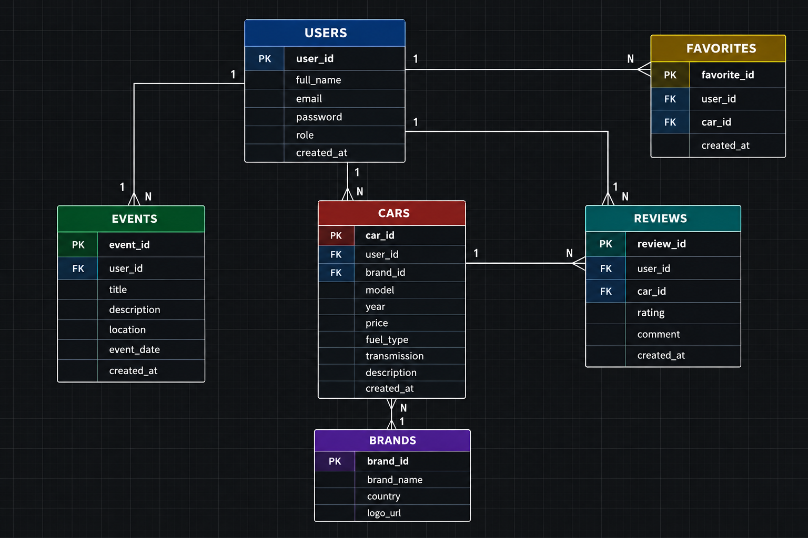

# CarHub

## 1. Project Description

CarHub is a web application for car enthusiasts that combines a car
marketplace with an automotive community.

Users will be able to explore car listings, view vehicle details, publish
car advertisements, save cars to their favorites, write reviews, and
discover automotive events.

The project is being developed as part of a Web Programming course.

## 2. Technology Stack

- Frontend: HTML, CSS, JavaScript
- Backend: PHP with FlightPHP
- Database: MySQL
- Database access: PHP PDO
- API documentation: OpenAPI / Swagger
- Version control: Git and GitHub

## 3. Main Features

- Browse and explore car listings.
- View detailed information about cars.
- Register and log in.
- Publish car advertisements.
- Save cars to favorites.
- Review and rate cars.
- Discover automotive events.
- Manage user profiles.

Note: The current milestone focuses on the static frontend and database
planning. Backend integration and functional account management are
planned for later milestones.

## 4. User Roles

The planned user roles are:

- Guest: Browse publicly available cars and events.
- Registered User: Manage a profile, publish advertisements, save
  favorite cars, and write reviews.
- Administrator: Manage users, listings, and platform content.

These roles and their permissions will be implemented in a later milestone.

### Test Accounts

Test accounts have not been created yet because authentication has not
been implemented.

Test credentials for each role will be added when the authentication
system is implemented.

## 5. Database Design

The planned database consists of the following entities:

- **Users** — stores user accounts and roles.
- **Cars** — stores car listings and vehicle information.
- **Brands** — stores car manufacturers.
- **Events** — stores automotive events.
- **Favorites** — connects users with their favorite cars.
- **Reviews** — stores user reviews and ratings for cars.

### Entity Relationships

- One user can publish multiple cars.
- One brand can be associated with multiple cars.
- One user can organize multiple events.
- One user can have multiple favorite cars.
- One car can be favorited by multiple users.
- One user can write multiple reviews.
- One car can have multiple reviews.

### Entity-Relationship Diagram

## 6. External API

An external API will be selected and integrated during a later milestone.

The selected API, its purpose, and the CarHub feature it supports will be
documented here after the integration plan is finalized.

## 7. Project Structure

The project is organized into separate frontend and backend directories.

- `frontend/` — HTML, CSS, JavaScript, page views, and static assets.
- `backend/` — PHP application, routes, services, DAO, middleware,
  configuration, and logs.
- `docs/` — project documentation, AI usage log, and database ERD.
- `AGENTS.md` — project architecture and development instructions.

## 8. Running the Project Locally

### Current Milestone: Static Frontend

1. Clone the GitHub repository.
2. Open the project in your code editor.
3. Open `frontend/index.html` using a local development server.
4. Navigate through the application using the navigation menu.

The frontend currently uses static demonstration data.

### Backend and Database Setup

Backend and database setup instructions will be added when the backend
and database are implemented.

The completed setup instructions will include:

- Required software and dependencies.
- Instructions for creating the local configuration file.
- Instructions for importing the SQL database file.
- Instructions for starting the backend server.

## 9. API Documentation

OpenAPI / Swagger documentation will be added when the REST API is
implemented.

**Swagger URL:** To be added.

## 10. Deployment

The application has not yet been deployed.

**Application URL:** To be added after deployment.

## 11. Project Documentation

- `AGENTS.md` — architecture and coding instructions.
- `docs/AI_LOG.md` — AI tools, prompts, identified issues, and corrections.
- `docs/ERD.png` — database entity-relationship diagram.

## 12. Project Status

Milestone 1 focuses on:

- Project structure and initial setup.
- Static frontend pages.
- SPA navigation.
- Initial database design.
- Project documentation.

Backend endpoints, database operations, authentication, and external API
integration are planned for subsequent milestones.